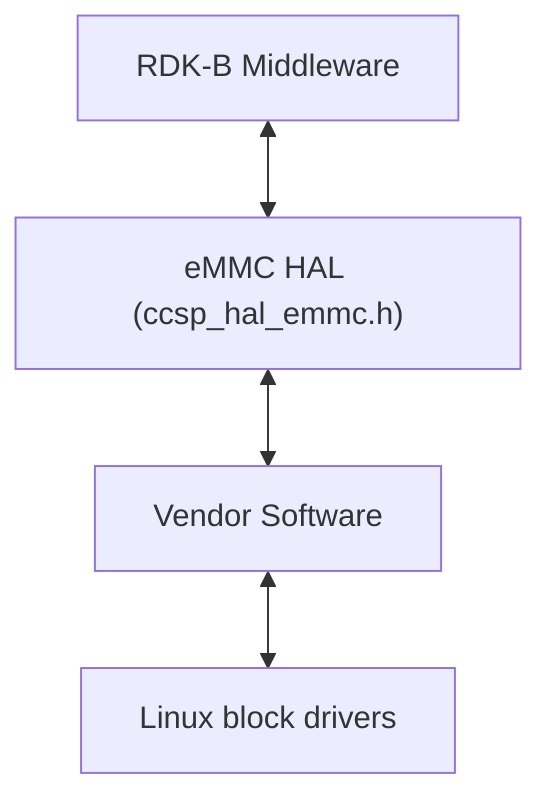
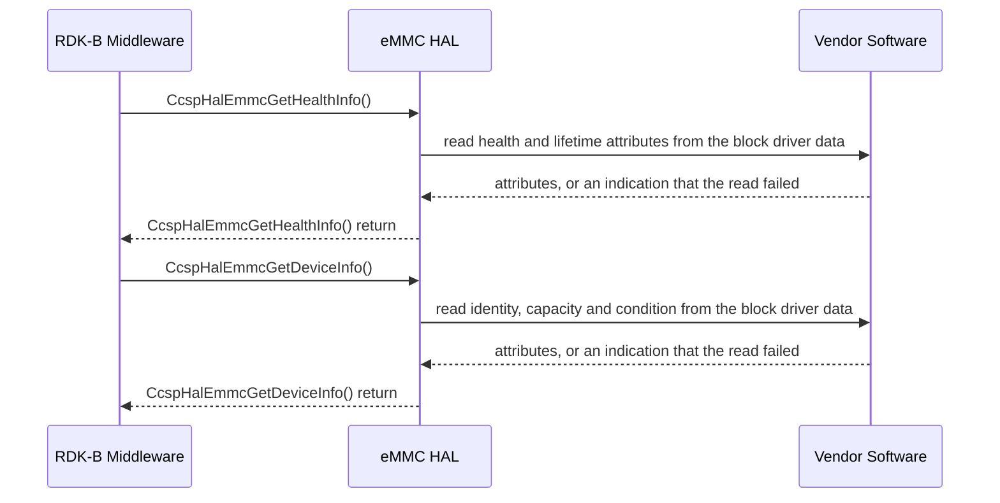

# eMMC HAL Documentation

## Version History

| Date | Comment | Version |
| --- | --- | --- |
| 2024-03-12 | Initial specification, published with release `1.0.0`. The page declared no document revision of its own. | 1.0.0 |
| 2026-08-24 | Restructured to the canonical HAL specification topic set. API surface, data types, status reporting and the absence of an asynchronous path documented against `include/ccsp_hal_emmc.h`. | 1.1.0 |

## Acronyms

- `HAL` \- Hardware Abstraction Layer
- `RDK-B` \- Reference Design Kit for Broadband Devices
- `eMMC` \- Embedded MultiMediaCard, the managed NAND flash device this interface reports on
- `SMART` \- Self-Monitoring, Analysis and Reporting Technology, the device self-diagnostics facility
- `SLA` \- Service Level Agreement

## Description

The diagram below describes a high-level software architecture of the eMMC HAL module stack.

The eMMC HAL is an abstraction layer over the Linux block drivers of the eMMC part, used to read its
health and device information. It is a common HAL, and **no dedicated middleware service owns it**:
any RDK-B Middleware component or process that needs those two records calls it directly.

## Optional Components

Both declared functions are always present. What is optional is part of what a vendor
implementation reports, and a caller that assumes either item below is present will misread the
record.

- `m_hasSMARTSupport`, a field of `eSTMGRDeviceInfo`, states whether the device reports `SMART` data.
  When it is false, the `SMART`-derived attributes of the health record carry no meaningful values.

- The diagnostics union `m_diagnostics` in `eSTMGRHealthInfo` holds one of two mutually exclusive
  forms: `m_list`, up to 20 structured name and value attributes, or `m_blob`, an opaque
  vendor-defined buffer of up to 2048 bytes. A vendor populates one arm, and no field of either record
  selects between them (`m_hasSMARTSupport` does not), so a caller reads neither arm without a vendor
  agreement establishing which form the implementation populates.

## Component Runtime Execution Requirements

### Initialization and Startup

The interface has no initialization, open or teardown call: a caller opens no session and has
nothing to release. The RDK-B Middleware calls the corresponding function at runtime whenever health
or device information is needed, and the following functions are guaranteed not to be called during
system bootup:

- `CcspHalEmmcGetHealthInfo`
- `CcspHalEmmcGetDeviceInfo`

Either function may block until the eMMC hardware is ready.

### Threading Model

**The interface is not required to be thread-safe.** Any module that calls an eMMC HAL function is
responsible for making its calls in a thread-safe manner, which in practice means serialising them.

Vendors may create internal threads and event mechanisms to meet their operational requirements.
Those mechanisms must synchronise access between the calls and events they serve, and must be
cleaned up when the vendor software terminates or closes its connection to the HAL.

### Process Model

Both functions are expected to be callable from multiple processes. The serialisation obligation in
`Threading Model` applies across processes as well as threads: callers coordinate concurrent use.

### Memory Model

Both functions write into a record that the caller allocates and owns. The HAL allocates no storage
for the caller and never takes ownership of the record.

#### Caller Responsibilities

- Allocate and release the record passed to each function: an `eSTMGRHealthInfo` or an
  `eSTMGRDeviceInfo`.
- Pass a non-`NULL` pointer to writable storage of the declared type that stays valid for the whole
  call. A wrong non-`NULL` pointer cannot be detected: the implementation writes through it and
  corrupts the caller's memory.
- Keep the record valid and unreused after the call unless the vendor confirms that its
  implementation does not retain the pointer.
- Bound every read of the record by the declared array sizes and element counts listed under
  `Data Structures and Defines`.

#### Module Responsibilities

- Manage the memory used for internal operations and release it on closure.
- Populate the caller's record in place, without allocating storage on the caller's behalf.

### Power Management Requirements

The eMMC HAL is not involved in any power management operation; neither function takes or returns a
power-related value.

### Asynchronous Notification Model

**There are no asynchronous notifications.** `eSTMGREvents`, `eSTMGREventMessage` and
`eSTMGRCallBackData` belong to the shared storage data model, and no declared function delivers them.
A caller that needs to observe a change calls the corresponding function again and compares the
records.

### Blocking calls

Both functions are synchronous: the outcome is in the return value when the call returns. Beyond the
wait for hardware readiness stated under `Initialization and Startup`, each call is expected to
complete within a period commensurate with the complexity of the operation, and an implementation
applies a timeout to any read that can fail for lack of a response.

### Internal Error Handling

Both functions report their outcome synchronously as an `eSTMGRReturns` return value; no failure is
reported out of band. The five codes, and the action a caller takes for each, are:

| Code | Value | Meaning | Caller action |
| --- | --- | --- | --- |
| `RDK_STMGR_RETURN_SUCCESS` | 0 | The record is populated with the fields the implementation could read | Read the populated fields |
| `RDK_STMGR_RETURN_GENERIC_FAILURE` | -1 | The read failed for a reason the implementation attributes to itself or the storage subsystem | Discard the record, log the failure and retry if needed; report a persistent failure to the vendor implementation's owner |
| `RDK_STMGR_RETURN_INIT_FAILURE` | -2 | The implementation could not bring up the resources it needs to reach the device | Treat the information as unavailable and retry later; there is no caller-side initialization step to repeat |
| `RDK_STMGR_RETURN_INVALID_INPUT` | -3 | The implementation rejected the call on an input or state check, such as a `NULL` pointer | Discard the record and correct the argument before calling again |
| `RDK_STMGR_RETURN_UNKNOWN_FAILURE` | -4 | The read failed for a reason the implementation cannot attribute | Act as for `RDK_STMGR_RETURN_GENERIC_FAILURE` |

On any failure code no field of the record may be relied on. The failure codes are negative, so a
caller tests the result against `RDK_STMGR_RETURN_SUCCESS` rather than for a non-zero value.

### Persistence Model

There is no requirement for the HAL to persist any setting information: neither function accepts a
value to store. A caller persists any settings its own implementation needs.

## Non functional requirements

The following non functional requirements should be supported by the eMMC HAL component.

### Logging and debugging requirements

The component is required to record all errors and critical informative messages, so that issues can
be identified and triaged and the functional flow of the system can be understood. Logging should use
`syslog`; `printf` is discouraged unless `syslog` is not available.

Where a vendor implementation logs, it must log to a file named `emmc_vendor_hal.log`. Log levels
follow the Linux standard logging system, in descending order of severity: **FATAL**, **ERROR**,
**WARNING**, **NOTICE**, **INFO**, **DEBUG** and **TRACE**. Each entry includes a timestamp, the log
level and a message describing the event or condition.

Implementations must not log credentials, secrets, security-sensitive information, or other sensitive data.
For this interface, device identifiers and serial numbers are sensitive data. The rule applies at
every log level, including **DEBUG** and **TRACE**, and to crash reports, diagnostic bundles and
telemetry; a failure status does not justify logging the record a call read.

### Memory and performance requirements

The eMMC HAL should not contribute disproportionately to memory or CPU utilisation while performing
normal operations, and its resource use should be commensurate with the operation required. Both
functions populate a fixed-size record, so neither has an input-dependent cost.

### Quality Control

To maintain software quality, it is recommended that the eMMC HAL implementation is verified without
errors using third-party tools such as `Coverity`, `Black Duck` and `Valgrind`, to detect and resolve
memory leaks, memory corruption and similar defects before deployment.

eMMC is not available on the HUB6 or XER10 reference platforms, so the runtime behaviour this
document describes, including blocking and resource use, has not been observed on reference hardware.

Any change to a file listed under `Source References` obliges a review of the topics that depend on
it, above all `include/ccsp_hal_emmc.h`. That review is addressed to the maintainer group the
repository's contribution guide directs contributions to: raise an issue in the repository's issue
tracker, open a pull request, and the team reviews it before it is merged to mainline.

### Licensing

The eMMC HAL implementation is expected to be released under the Apache License 2.0. The licence
text is in [LICENSE.md](LICENSE.md), also published as [COPYING.md](COPYING.md), and the copyright
and attribution notice is in [NOTICE.md](NOTICE.md).

### Build Requirements

The eMMC HAL source code should be capable of being built under the Linux Yocto environment, and the
recipe should deliver a **shared library** named `libhal_emmc.so`. The header's only external
dependency is the C standard header `<stdbool.h>`.

### Variability Management

The role of adjusting the interface, guided by versioning, rests solely within architecture
requirements. Thereafter, vendors are obliged to align their implementation with a designated version
of the interface. As per `SLA` terms, they may transition to newer versions based on demand needs.

Each API interface will be versioned using [Semantic Versioning 2.0.0](https://semver.org/spec/v2.0.0.html), and the
vendor code will comply with a specific version of the interface.

The header has no conditional compilation other than its include guard, so the declarations a caller
compiles against are the same on every platform.

### Platform or Product Customization

A product customises this interface only through the vendor implementation behind it. The values that
implementation reports \- device identity, capacity, condition flags and the diagnostics form \- are
the whole of the observable variation.

## Interface API Documentation

All HAL function prototypes and data type definitions are in the `ccsp_hal_emmc.h` header file,
where the Doxygen block on each declaration carries the per-function detail \- argument bounds,
pre-conditions, post-conditions, every return value and its consequence, blocking behaviour and
thread safety \- that this document indexes rather than repeats.

To use the eMMC HAL from a component or process:

1. **Inclusion:** include `ccsp_hal_emmc.h` in the source that calls the interface.
2. **Linking:** add a linker dependency on `libhal_emmc`.

### Theory of operation and key concepts

eMMC health and device information is populated on the device globally. This interface fetches that
information from the data the block drivers have already populated: it is a reader over existing
kernel-side data rather than a driver in its own right.

Two records express the whole contract. `eSTMGRHealthInfo` answers "is this part working and how much
life is left in it", carrying the operational and health flags and up to five sets of diagnostic
attributes. `eSTMGRDeviceInfo` answers "what part is this and what condition is it in", carrying
identity, capacity and the condition flags. Each has one function that populates it.

#### Object Lifecycles

**The HAL creates no objects.** There is no handle, descriptor or open/close pairing. The only
lifecycle is that of the caller's own record, which `Memory Model` governs.

#### Method Sequencing

**No call ordering is imposed.** The two functions may be called in any order, independently and as
often as needed. Neither depends on the other having been called, and neither leaves state behind
that the other observes.

#### State-Dependent Behavior

What a call reports varies with the condition of the device, through the condition flags in
`eSTMGRDeviceInfo.m_status` and the `m_isOperational` and `m_isHealthy` flags in `eSTMGRHealthInfo`.
While `RDK_STMGR_DEVICE_STATUS_NOT_PRESENT` is set, the identity and capacity fields carry no
meaningful value. A caller reads `m_isOperational` and `m_isHealthy` independently rather than
inferring one from the other.

### Data Structures and Defines

Every type below is declared in `ccsp_hal_emmc.h` under the `EMMC_HAL_TYPES` documentation group.
Only `eSTMGRHealthInfo` and `eSTMGRDeviceInfo` appear in a function signature, and they are the only
two structures a caller constructs. Every other type either appears inside one of those two or is
used by no declared function; the tables mark both cases.

**Valued macros.** The macros are array sizes and element counts. Where a count accompanies an array,
the count bounds what a caller may read, not the macro.

| Define | Value | What it bounds |
| --- | --- | --- |
| `RDK_STMGR_MAX_DEVICES` | 10 | Element count of the per-device arrays in `eSTMGRDeviceIDs` and `eSTMGRDeviceInfoList` |
| `RDK_STMGR_MAX_STRING_LENGTH` | 128 | Size in bytes of every fixed identity and text array in the interface; a caller bounds string reads by it rather than relying on a terminating `NUL` |
| `RDK_STMGR_PARTITION_LENGTH` | 256 | Size in bytes of `eSTMGRDeviceInfo.m_partitions`, whose layout is vendor-specific |
| `RDK_STMGR_DIAGNOSTICS_LENGTH` | 256 | Size in bytes of `eSTMGREventMessage.m_diagnostics` |
| `RDK_STMGR_DIAGNOSTICS_BLOB_LENGTH` | 2048 | Size in bytes of the opaque diagnostics buffer `eSTMGRHealthInfo.m_diagnostics.m_blob` |
| `RDK_STMGR_MAX_DIAGNOSTIC_ATTRIBUTES` | 20 | Element count of the `SMART` attribute array in `eSTMGRDiagAttributesList` |

**The status code both functions return, `eSTMGRReturns`.** Its five codes, their values and the
caller action for each are listed under `Internal Error Handling`.

**The class of medium a record describes, `eSTMGRDeviceType`.**

| Member | Value |
| --- | --- |
| `RDK_STMGR_DEVICE_TYPE_HDD` | 0 |
| `RDK_STMGR_DEVICE_TYPE_SDCARD` | 1 |
| `RDK_STMGR_DEVICE_TYPE_USB` | 2 |
| `RDK_STMGR_DEVICE_TYPE_FLASH` | 3 |
| `RDK_STMGR_DEVICE_TYPE_NVRAM` | 4 |
| `RDK_STMGR_DEVICE_TYPE_EMMCCARD` | 5 |
| `RDK_STMGR_DEVICE_TYPE_MAX` | 6 |

The enumeration is shared with the wider RDK storage data model, which is why it names media this
HAL does not report on. An eMMC implementation reports `RDK_STMGR_DEVICE_TYPE_EMMCCARD`.
`RDK_STMGR_DEVICE_TYPE_MAX` is a bound, not a device class.

**Condition flags, `eSTMGRDeviceStatus` \- the type most easily mis-used.**

**The non-zero members are bit flags, so a caller must test a status field with a bitwise AND and
must not compare it for equality against a single member.** An implementation may report several
conditions at once by combining them with a bitwise OR, so a field carrying both
`RDK_STMGR_DEVICE_STATUS_READ_ONLY` and `RDK_STMGR_DEVICE_STATUS_DISK_FULL` equals neither of them.

| Flag | Bit value | Meaning |
| --- | --- | --- |
| `RDK_STMGR_DEVICE_STATUS_OK` | 0 | No condition flag is set; recognised by comparing the whole field against zero |
| `RDK_STMGR_DEVICE_STATUS_READ_ONLY` | `1 << 0` | Reads are accepted but writes are not |
| `RDK_STMGR_DEVICE_STATUS_NOT_PRESENT` | `1 << 1` | No medium is present |
| `RDK_STMGR_DEVICE_STATUS_NOT_QUALIFIED` | `1 << 2` | A medium is present but is not a part the platform qualifies |
| `RDK_STMGR_DEVICE_STATUS_DISK_FULL` | `1 << 3` | No free space remains |
| `RDK_STMGR_DEVICE_STATUS_READ_FAILURE` | `1 << 4` | A read against the medium failed |
| `RDK_STMGR_DEVICE_STATUS_WRITE_FAILURE` | `1 << 5` | A write against the medium failed |
| `RDK_STMGR_DEVICE_STATUS_UNKNOWN` | `1 << 6` | The implementation could not determine the condition |

**Event identifiers with no delivery path, `eSTMGREvents`.**

| Member | Value | Meaning |
| --- | --- | --- |
| `RDK_STMGR_EVENT_STATUS_CHANGED` | 100 | The condition flags reported for a device changed |
| `RDK_STMGR_EVENT_HEALTH_WARNING` | 101 | A health indicator crossed a threshold |
| `RDK_STMGR_EVENT_DEVICE_FAILURE` | 102 | The device failed and can no longer be relied on |

**Structures.**

| Structure | What it represents and whether a caller uses it |
| --- | --- |
| `eSTMGRDeviceIDs` | A bounded list of device identifiers. **Not populated by any declared function** |
| `eSTMGRDeviceInfo` | Identity, capacity and condition of one device. **Caller-constructed**, populated by `CcspHalEmmcGetDeviceInfo` |
| `eSTMGRDeviceInfoList` | A bounded list of `eSTMGRDeviceInfo` records. **Not populated by any declared function** |
| `eSTMGRPartitionInfo` | Identity, mount path, format, condition and capacity of one partition. **Not populated by any declared function** |
| `eSTMGRDiagAttributes` | One `SMART` diagnostic attribute as a name and a value. Read inside a health record |
| `eSTMGRDiagAttributesList` | Up to 20 `eSTMGRDiagAttributes` with the count that are valid. Read inside a health record |
| `eSTMGRHealthInfo` | Operational and health state with the diagnostics union and four attribute lists. **Caller-constructed**, populated by `CcspHalEmmcGetHealthInfo` |
| `eSTMGREventMessage` | An event, the device it concerns and its diagnostic context. **Not delivered by any declared function** |
| `eSTMGRCallBackData` | Callback context: an SD-card flag and a mount path. **Not passed by any declared function** |

Two points a caller needs from the records it constructs, in addition to the diagnostics union under
`Optional Components`:

- `eSTMGRDeviceInfo.m_capacity` carries no unit, so a caller must not assume bytes; the capacity and
  free-space fields of `eSTMGRPartitionInfo` are in bytes.
- Every text field is a fixed-size array of vendor-supplied text. Identity, model, firmware and
  hardware version and the partition description are read as opaque text, not parsed against a fixed
  format.

### API Surface

This interface declares **two** functions. Both are read-only, are called on demand, take a single
caller-allocated out-parameter and return an `eSTMGRReturns` status code.

**Health retrieval**

- `CcspHalEmmcGetHealthInfo` \- reads the health record of the eMMC device into a caller-supplied
  structure: identity and class, the operational and health flags, the diagnostics union and the four
  lifetime and health attribute lists.
  Signature: `eSTMGRReturns CcspHalEmmcGetHealthInfo(eSTMGRHealthInfo* pHealthInfo)`.

**Device information retrieval**

- `CcspHalEmmcGetDeviceInfo` \- reads the identity and condition of the eMMC device into a
  caller-supplied structure: identifier, device class, capacity, condition flags, partition
  description, manufacturer, model, serial number, firmware and hardware version, declared ATA
  standard and `SMART` support.
  Signature: `eSTMGRReturns CcspHalEmmcGetDeviceInfo(eSTMGRDeviceInfo* pDeviceInfo)`.

### Sequence Diagram

The RDK-B Middleware may make the two calls below in either order or on their own.

### State Diagram

No state diagram is drawn: the interface defines status values but no transitions between them. The
status values are:

- the `eSTMGRDeviceStatus` condition flags reported in `eSTMGRDeviceInfo.m_status`:
  `RDK_STMGR_DEVICE_STATUS_OK`, `RDK_STMGR_DEVICE_STATUS_READ_ONLY`,
  `RDK_STMGR_DEVICE_STATUS_NOT_PRESENT`, `RDK_STMGR_DEVICE_STATUS_NOT_QUALIFIED`,
  `RDK_STMGR_DEVICE_STATUS_DISK_FULL`, `RDK_STMGR_DEVICE_STATUS_READ_FAILURE`,
  `RDK_STMGR_DEVICE_STATUS_WRITE_FAILURE` and `RDK_STMGR_DEVICE_STATUS_UNKNOWN`;
- the `m_isOperational` and `m_isHealthy` flags in `eSTMGRHealthInfo`.

## Source References

- [rdkcentral/rdkb-halif-emmc/include/ccsp_hal_emmc.h](https://github.com/rdkcentral/rdkb-halif-emmc/blob/develop/include/ccsp_hal_emmc.h) — the interface header: functions, data types, return codes and their Doxygen contract
- [rdkcentral/rdkb-halif-emmc/CHANGELOG.md](https://github.com/rdkcentral/rdkb-halif-emmc/blob/develop/CHANGELOG.md) — release history
- [rdkcentral/rdkb-halif-emmc/CONTRIBUTING.md](https://github.com/rdkcentral/rdkb-halif-emmc/blob/develop/CONTRIBUTING.md) — contribution and review process
- [rdkcentral/rdkb-halif-emmc/LICENSE](https://github.com/rdkcentral/rdkb-halif-emmc/blob/develop/LICENSE) — licence text
- [rdkcentral/rdkb-halif-emmc/NOTICE](https://github.com/rdkcentral/rdkb-halif-emmc/blob/develop/NOTICE) — copyright and attribution notice
